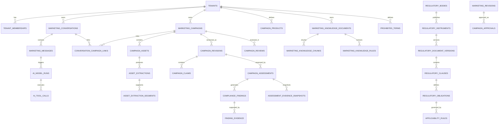

# COGENT MARKETING SHIELD
## Database and Data Model Specification

**Product Name:** Cogent Marketing Shield  
**Product Type:** Standalone Enterprise Regulatory & Marketing Compliance Operating System  
**Document Number:** 03  
**Document Title:** Database and Data Model Specification  
**Version:** 2.0 (Greenfield Source of Truth)  
**Status:** Approved Technical Baseline for Database Implementation  
**Primary Database:** Supabase PostgreSQL with `pgvector`  
**AI Provider & SDK:** Google Gemini API (`@google/genai` SDK — `text-embedding-004` for 768-dim vectors)  
**Primary Market:** Nigerian Regulated Financial Institutions

---

# 1. Purpose and Objectives

## 1.1 Purpose
This document defines the greenfield database architecture, relational schema, vector indexes, and Row Level Security (RLS) policies for **Cogent Marketing Shield**. 

Because this is a 100% greenfield rebuild, this schema contains **zero legacy tables, zero deprecated scanner structures, and one unified canonical data model** from Day 1.

It translates the Product Requirements Document (`01_PRD.md`) and Target System Architecture (`02_Target_System_Architecture.md`) into a strict database specification that engineering and the Gemini Antigravity IDE will implement without ambiguity.

## 1.2 Primary Objectives
The database must:
- Enforce strict tenant isolation via composite foreign keys and PostgreSQL Row Level Security (RLS).
- Maintain persistent, multi-turn conversations and message ordering.
- Manage structured campaign lifecycles across 11 canonical states.
- Preserve immutable `campaign_revisions` and structured text/claim diffs.
- Store multi-format campaign assets (`campaign_assets`), SHA-256 hashes, OCR provenance, and bounding-box segments (`asset_extraction_segments`).
- House the **Golden 50 Statutory Vault** (`regulatory_*` tables) with `VECTOR(768)` embeddings for hybrid semantic + full-text RRF retrieval.
- House the tenant-isolated **Institutional Knowledge Base & Playbook Engine** (`marketing_knowledge_*` chunks, rules, and `campaign_products` rate/fee schedules).
- Record real-time **Live Web Intelligence** snapshots (`live_web_retrievals`) with strict source-class separation.
- Record multi-source `compliance_findings`, evidence links (`finding_evidence`), and immutable `assessment_evidence_snapshots`.
- Enforce role-based review workflows and cryptographic human `campaign_approvals` bound strictly to a specific `revision_id`.
- Support asynchronous background jobs (`processing_jobs`) with idempotency keys and retry tracking.
- Maintain tamper-evident, hash-chained audit logs (`marketing_audit_events`).

---

# 2. Database Design Principles

1. **Single Source of Truth:** Every core business object (`conversation`, `campaign`, `revision`, `finding`, `approval`) has a single authoritative table. Competing data representations are strictly prohibited.
2. **Strict Multi-Tenant Isolation (`tenant_id`):** Every tenant-owned table includes `tenant_id UUID NOT NULL` and implements composite unique constraints (`UNIQUE (tenant_id, id)`) alongside composite foreign keys (`FOREIGN KEY (tenant_id, parent_id) REFERENCES parent_table (tenant_id, id)`).
3. **Source-Class Separation:** Global statutory data (`VERIFIED_OFFICIAL_SOURCE`), tenant internal playbooks (`INTERNAL_PLAYBOOK`), and live web retrievals (`LIVE_WEB_INTELLIGENCE`) reside in distinct relational structures.
4. **Immutable Historical Records:** Original campaign submissions, past revisions, approval decisions, and assessment-time evidence snapshots are never overwritten or deleted; changes create new version records.
5. **Backend-Controlled Authority:** The database schema and server-side services enforce permissions, state transitions, and evidence validation. Gemini can never bypass relational constraints or execute raw SQL.

---

# 3. Complete Relational Schema & Table Definitions

## 3.1 Identity & Tenancy Domain

### `tenants`
Represents institutional subscribers using Cogent Marketing Shield.
```sql
CREATE TABLE tenants (
    id UUID PRIMARY KEY DEFAULT gen_random_uuid(),
    name TEXT NOT NULL,
    slug TEXT NOT NULL UNIQUE,
    status TEXT NOT NULL DEFAULT 'ACTIVE' CHECK (status IN ('ACTIVE', 'SUSPENDED', 'INACTIVE')),
    settings JSONB NOT NULL DEFAULT '{}'::jsonb,
    created_at TIMESTAMPTZ NOT NULL DEFAULT timezone('utc'::text, now()),
    updated_at TIMESTAMPTZ NOT NULL DEFAULT timezone('utc'::text, now())
);
```

### `tenant_memberships`
Connects authenticated users (Supabase Auth `auth.users`) to institutions with RBAC roles.
```sql
CREATE TABLE tenant_memberships (
    id UUID PRIMARY KEY DEFAULT gen_random_uuid(),
    tenant_id UUID NOT NULL REFERENCES tenants(id) ON DELETE CASCADE,
    user_id UUID NOT NULL REFERENCES auth.users(id) ON DELETE CASCADE,
    role TEXT NOT NULL CHECK (role IN ('MARKETING_GROWTH', 'COMPLIANCE_ANALYST', 'LEGAL_COUNSEL', 'CHIEF_COMPLIANCE_OFFICER', 'WORKSPACE_ADMIN')),
    status TEXT NOT NULL DEFAULT 'ACTIVE' CHECK (status IN ('ACTIVE', 'INVITED', 'SUSPENDED')),
    joined_at TIMESTAMPTZ NOT NULL DEFAULT timezone('utc'::text, now()),
    created_at TIMESTAMPTZ NOT NULL DEFAULT timezone('utc'::text, now()),
    updated_at TIMESTAMPTZ NOT NULL DEFAULT timezone('utc'::text, now()),
    CONSTRAINT tenant_memberships_tenant_user_unique UNIQUE (tenant_id, user_id)
);
```

---

## 3.2 Conversation Domain

### `marketing_conversations`
Persistent conversation sessions between users and the Copilot.
```sql
CREATE TABLE marketing_conversations (
    id UUID PRIMARY KEY DEFAULT gen_random_uuid(),
    tenant_id UUID NOT NULL REFERENCES tenants(id) ON DELETE CASCADE,
    created_by UUID NOT NULL REFERENCES auth.users(id),
    title TEXT NOT NULL,
    status TEXT NOT NULL DEFAULT 'ACTIVE' CHECK (status IN ('ACTIVE', 'ARCHIVED', 'CLOSED')),
    context_type TEXT NOT NULL DEFAULT 'GENERAL' CHECK (context_type IN ('GENERAL', 'REGULATORY', 'CAMPAIGN')),
    active_campaign_id UUID, -- References marketing_campaigns(id) logically or via FK if created
    last_message_at TIMESTAMPTZ NOT NULL DEFAULT timezone('utc'::text, now()),
    metadata JSONB NOT NULL DEFAULT '{}'::jsonb,
    created_at TIMESTAMPTZ NOT NULL DEFAULT timezone('utc'::text, now()),
    updated_at TIMESTAMPTZ NOT NULL DEFAULT timezone('utc'::text, now()),
    CONSTRAINT marketing_conversations_tenant_id_id_unique UNIQUE (tenant_id, id)
);
```

### `marketing_messages`
Individual chat messages within a conversation.
```sql
CREATE TABLE marketing_messages (
    id UUID PRIMARY KEY DEFAULT gen_random_uuid(),
    tenant_id UUID NOT NULL REFERENCES tenants(id) ON DELETE CASCADE,
    conversation_id UUID NOT NULL,
    role TEXT NOT NULL CHECK (role IN ('USER', 'ASSISTANT', 'SYSTEM', 'TOOL')),
    content TEXT NOT NULL,
    content_type TEXT NOT NULL DEFAULT 'TEXT' CHECK (content_type IN ('TEXT', 'STRUCTURED', 'MIXED')),
    status TEXT NOT NULL DEFAULT 'COMPLETED' CHECK (status IN ('PENDING', 'STREAMING', 'COMPLETED', 'FAILED')),
    sequence_number BIGINT NOT NULL,
    parent_message_id UUID REFERENCES marketing_messages(id),
    model_run_id UUID, -- References ai_model_runs(id)
    metadata JSONB NOT NULL DEFAULT '{}'::jsonb,
    created_at TIMESTAMPTZ NOT NULL DEFAULT timezone('utc'::text, now()),
    CONSTRAINT marketing_messages_tenant_id_id_unique UNIQUE (tenant_id, id),
    CONSTRAINT fk_marketing_messages_conversation FOREIGN KEY (tenant_id, conversation_id) 
        REFERENCES marketing_conversations(tenant_id, id) ON DELETE CASCADE
);
```

### `conversation_campaign_links`
Explicit associations between chat conversations and campaign workspaces.
```sql
CREATE TABLE conversation_campaign_links (
    id UUID PRIMARY KEY DEFAULT gen_random_uuid(),
    tenant_id UUID NOT NULL REFERENCES tenants(id) ON DELETE CASCADE,
    conversation_id UUID NOT NULL,
    campaign_id UUID NOT NULL,
    relationship_type TEXT NOT NULL DEFAULT 'ORIGINATING' CHECK (relationship_type IN ('ORIGINATING', 'RELATED', 'FOLLOW_UP')),
    created_at TIMESTAMPTZ NOT NULL DEFAULT timezone('utc'::text, now()),
    CONSTRAINT conversation_campaign_links_tenant_id_id_unique UNIQUE (tenant_id, id),
    CONSTRAINT fk_conv_camp_conversation FOREIGN KEY (tenant_id, conversation_id) 
        REFERENCES marketing_conversations(tenant_id, id) ON DELETE CASCADE
);
```

---

## 3.3 Campaign Management Domain

### `marketing_campaigns`
Authoritative campaign record maintaining the 11-state canonical lifecycle.
```sql
CREATE TABLE marketing_campaigns (
    id UUID PRIMARY KEY DEFAULT gen_random_uuid(),
    tenant_id UUID NOT NULL REFERENCES tenants(id) ON DELETE CASCADE,
    conversation_id UUID,
    created_by UUID NOT NULL REFERENCES auth.users(id),
    campaign_name TEXT NOT NULL,
    description TEXT,
    campaign_type TEXT NOT NULL DEFAULT 'PROMOTIONAL',
    channel TEXT NOT NULL CHECK (channel IN ('SOCIAL_MEDIA', 'SMS', 'WEB_LANDING', 'PRINT_FLYER', 'EMAIL', 'RADIO_TV', 'INFLUENCER', 'OTHER')),
    product_id UUID, -- References campaign_products(id)
    status TEXT NOT NULL DEFAULT 'DRAFT' CHECK (status IN (
        'DRAFT', 'SUBMITTED', 'PROCESSING', 'ASSESSMENT_IN_PROGRESS', 
        'FINDINGS_AVAILABLE', 'REVISION_REQUIRED', 'RESUBMITTED', 
        'UNDER_REVIEW', 'APPROVED', 'REJECTED', 'ARCHIVED'
    )),
    risk_level TEXT DEFAULT 'PENDING' CHECK (risk_level IN ('PENDING', 'LOW', 'MEDIUM', 'HIGH', 'CRITICAL')),
    current_revision_id UUID,
    approved_revision_id UUID,
    submitted_at TIMESTAMPTZ,
    created_at TIMESTAMPTZ NOT NULL DEFAULT timezone('utc'::text, now()),
    updated_at TIMESTAMPTZ NOT NULL DEFAULT timezone('utc'::text, now()),
    archived_at TIMESTAMPTZ,
    metadata JSONB NOT NULL DEFAULT '{}'::jsonb,
    CONSTRAINT marketing_campaigns_tenant_id_id_unique UNIQUE (tenant_id, id)
);
```

### `campaign_status_history`
Immutable ledger of campaign lifecycle state transitions.
```sql
CREATE TABLE campaign_status_history (
    id UUID PRIMARY KEY DEFAULT gen_random_uuid(),
    tenant_id UUID NOT NULL REFERENCES tenants(id) ON DELETE CASCADE,
    campaign_id UUID NOT NULL,
    previous_status TEXT,
    new_status TEXT NOT NULL,
    changed_by UUID NOT NULL REFERENCES auth.users(id),
    reason TEXT,
    created_at TIMESTAMPTZ NOT NULL DEFAULT timezone('utc'::text, now()),
    CONSTRAINT fk_status_history_campaign FOREIGN KEY (tenant_id, campaign_id) 
        REFERENCES marketing_campaigns(tenant_id, id) ON DELETE CASCADE
);
```

### `campaign_products`
Structured institutional product truth (interest rates, APRs, fees, tenors) used by Deterministic Lock 2.
```sql
CREATE TABLE campaign_products (
    id UUID PRIMARY KEY DEFAULT gen_random_uuid(),
    tenant_id UUID NOT NULL REFERENCES tenants(id) ON DELETE CASCADE,
    product_name TEXT NOT NULL,
    product_type TEXT NOT NULL,
    description TEXT,
    approved_terms JSONB NOT NULL DEFAULT '{}'::jsonb, -- e.g. { "interest_rate_max": 4.0, "processing_fee_percent": 1.5, "max_tenor_days": 90 }
    status TEXT NOT NULL DEFAULT 'ACTIVE' CHECK (status IN ('ACTIVE', 'INACTIVE')),
    created_at TIMESTAMPTZ NOT NULL DEFAULT timezone('utc'::text, now()),
    updated_at TIMESTAMPTZ NOT NULL DEFAULT timezone('utc'::text, now()),
    CONSTRAINT campaign_products_tenant_id_id_unique UNIQUE (tenant_id, id)
);
```

---

## 3.4 Asset & File Management Domain

### `campaign_assets`
Metadata records for uploaded campaign files, flyers, documents, and promotional URLs.
```sql
CREATE TABLE campaign_assets (
    id UUID PRIMARY KEY DEFAULT gen_random_uuid(),
    tenant_id UUID NOT NULL REFERENCES tenants(id) ON DELETE CASCADE,
    campaign_id UUID,
    conversation_id UUID,
    uploaded_by UUID NOT NULL REFERENCES auth.users(id),
    original_filename TEXT NOT NULL,
    storage_provider TEXT NOT NULL DEFAULT 'SUPABASE_STORAGE',
    storage_bucket TEXT NOT NULL DEFAULT 'marketing-shield-private',
    storage_key TEXT NOT NULL,
    mime_type TEXT NOT NULL,
    file_extension TEXT NOT NULL,
    file_size_bytes BIGINT NOT NULL,
    sha256_hash TEXT NOT NULL,
    asset_type TEXT NOT NULL CHECK (asset_type IN ('IMAGE', 'PDF', 'DOCX', 'TEXT', 'URL')),
    processing_status TEXT NOT NULL DEFAULT 'PENDING' CHECK (processing_status IN ('PENDING', 'PROCESSING', 'EXTRACTED', 'FAILED', 'REJECTED')),
    malware_status TEXT NOT NULL DEFAULT 'PENDING' CHECK (malware_status IN ('PENDING', 'CLEAN', 'SUSPICIOUS', 'FAILED')),
    extraction_status TEXT NOT NULL DEFAULT 'PENDING' CHECK (extraction_status IN ('PENDING', 'COMPLETED', 'FAILED')),
    uploaded_at TIMESTAMPTZ NOT NULL DEFAULT timezone('utc'::text, now()),
    processed_at TIMESTAMPTZ,
    metadata JSONB NOT NULL DEFAULT '{}'::jsonb,
    CONSTRAINT campaign_assets_tenant_id_id_unique UNIQUE (tenant_id, id)
);
```

### `asset_extractions`
Extracted text and metadata resulting from OCR or document parsing.
```sql
CREATE TABLE asset_extractions (
    id UUID PRIMARY KEY DEFAULT gen_random_uuid(),
    tenant_id UUID NOT NULL REFERENCES tenants(id) ON DELETE CASCADE,
    asset_id UUID NOT NULL,
    extraction_method TEXT NOT NULL CHECK (extraction_method IN ('OCR', 'PDF_PARSER', 'DOCX_PARSER', 'URL_SCRAPER', 'DIRECT_TEXT')),
    extraction_version TEXT NOT NULL DEFAULT 'v2.0',
    extracted_text TEXT NOT NULL,
    language TEXT DEFAULT 'en',
    extraction_confidence NUMERIC(5,2),
    extraction_status TEXT NOT NULL DEFAULT 'COMPLETED',
    page_count INTEGER DEFAULT 1,
    metadata JSONB NOT NULL DEFAULT '{}'::jsonb,
    created_at TIMESTAMPTZ NOT NULL DEFAULT timezone('utc'::text, now()),
    CONSTRAINT asset_extractions_tenant_id_id_unique UNIQUE (tenant_id, id),
    CONSTRAINT fk_asset_extractions_asset FOREIGN KEY (tenant_id, asset_id) 
        REFERENCES campaign_assets(tenant_id, id) ON DELETE CASCADE
);
```

### `asset_extraction_segments`
Granular text segments with page numbers and bounding-box coordinates for exact claim provenance.
```sql
CREATE TABLE asset_extraction_segments (
    id UUID PRIMARY KEY DEFAULT gen_random_uuid(),
    tenant_id UUID NOT NULL REFERENCES tenants(id) ON DELETE CASCADE,
    asset_id UUID NOT NULL,
    extraction_id UUID NOT NULL,
    segment_index INTEGER NOT NULL,
    text_content TEXT NOT NULL,
    page_number INTEGER DEFAULT 1,
    bounding_box JSONB, -- { "x": 10, "y": 20, "width": 80, "height": 15 }
    source_type TEXT NOT NULL CHECK (source_type IN ('DIRECT_TEXT', 'OCR')),
    metadata JSONB NOT NULL DEFAULT '{}'::jsonb,
    created_at TIMESTAMPTZ NOT NULL DEFAULT timezone('utc'::text, now()),
    CONSTRAINT asset_extraction_segments_tenant_id_id_unique UNIQUE (tenant_id, id),
    CONSTRAINT fk_segments_asset FOREIGN KEY (tenant_id, asset_id) 
        REFERENCES campaign_assets(tenant_id, id) ON DELETE CASCADE
);
```

---

## 3.5 Claim Management Domain

### `campaign_claims`
Extracted promotional claims mapped to their exact source provenance.
```sql
CREATE TABLE campaign_claims (
    id UUID PRIMARY KEY DEFAULT gen_random_uuid(),
    tenant_id UUID NOT NULL REFERENCES tenants(id) ON DELETE CASCADE,
    campaign_id UUID NOT NULL,
    asset_id UUID REFERENCES campaign_assets(id),
    extraction_segment_id UUID REFERENCES asset_extraction_segments(id),
    claim_text TEXT NOT NULL,
    normalized_claim TEXT,
    claim_category TEXT NOT NULL CHECK (claim_category IN (
        'INTEREST_RATE_OR_APR', 'FEE_OR_CHARGE_REPRESENTATION', 'GUARANTEED_APPROVAL_OR_RETURN',
        'SPEED_OR_INSTANT_DISBURSEMENT', 'PROMOTIONAL_OFFER_OR_DISCOUNT', 'ELIGIBILITY_OR_TENOR_TERM',
        'REGULATORY_ENDORSEMENT_OR_LICENSE_CLAIM', 'SECURITY_OR_DATA_PRIVACY_CLAIM',
        'COMPARATIVE_OR_SUPERLATIVE_CLAIM', 'MANDATORY_DISCLOSURE_OR_DISCLAIMER', 'INFLUENCER_OR_TESTIMONIAL_REPRESENTATION'
    )),
    extraction_method TEXT NOT NULL,
    extraction_confidence NUMERIC(5,2),
    verification_status TEXT NOT NULL DEFAULT 'EXTRACTED' CHECK (verification_status IN ('EXTRACTED', 'VERIFIED', 'UNCERTAIN', 'REJECTED')),
    revision_id UUID, -- References campaign_revisions(id)
    created_at TIMESTAMPTZ NOT NULL DEFAULT timezone('utc'::text, now()),
    updated_at TIMESTAMPTZ NOT NULL DEFAULT timezone('utc'::text, now()),
    CONSTRAINT campaign_claims_tenant_id_id_unique UNIQUE (tenant_id, id),
    CONSTRAINT fk_claims_campaign FOREIGN KEY (tenant_id, campaign_id) 
        REFERENCES marketing_campaigns(tenant_id, id) ON DELETE CASCADE
);
```

---

## 3.6 Regulatory Intelligence Domain — The "Golden 50" Statutory Vault

### `regulatory_bodies`
Regulators and supervisory authorities.
```sql
CREATE TABLE regulatory_bodies (
    id UUID PRIMARY KEY DEFAULT gen_random_uuid(),
    name TEXT NOT NULL,
    acronym TEXT NOT NULL UNIQUE, -- e.g. CBN, FCCPC, ARCON, NDPC, SEC
    description TEXT,
    official_domain TEXT NOT NULL,
    status TEXT NOT NULL DEFAULT 'ACTIVE' CHECK (status IN ('ACTIVE', 'INACTIVE')),
    created_at TIMESTAMPTZ NOT NULL DEFAULT timezone('utc'::text, now())
);
```

### `regulatory_instruments`
Statutory Acts, Regulations, Guidelines, Circulars, and Codes.
```sql
CREATE TABLE regulatory_instruments (
    id UUID PRIMARY KEY DEFAULT gen_random_uuid(),
    regulator_id UUID NOT NULL REFERENCES regulatory_bodies(id) ON DELETE CASCADE,
    title TEXT NOT NULL,
    instrument_type TEXT NOT NULL CHECK (instrument_type IN ('ACT', 'REGULATION', 'GUIDELINE', 'CIRCULAR', 'CODE', 'DIRECTIVE', 'NOTICE')),
    jurisdiction TEXT NOT NULL DEFAULT 'NIGERIA',
    instrument_number TEXT,
    description TEXT,
    status TEXT NOT NULL DEFAULT 'ACTIVE' CHECK (status IN ('ACTIVE', 'SUPERSEDED', 'DRAFT', 'REPEALED')),
    created_at TIMESTAMPTZ NOT NULL DEFAULT timezone('utc'::text, now()),
    updated_at TIMESTAMPTZ NOT NULL DEFAULT timezone('utc'::text, now())
);
```

### `regulatory_document_versions`
Specific verified versions of regulatory instruments with cryptographic hashes.
```sql
CREATE TABLE regulatory_document_versions (
    id UUID PRIMARY KEY DEFAULT gen_random_uuid(),
    instrument_id UUID NOT NULL REFERENCES regulatory_instruments(id) ON DELETE CASCADE,
    version_number TEXT NOT NULL,
    source_url TEXT NOT NULL,
    document_hash TEXT NOT NULL, -- SHA-256 hash of original official PDF
    storage_key TEXT NOT NULL, -- Private object storage key
    publication_date DATE NOT NULL,
    effective_date DATE NOT NULL,
    expiry_date DATE,
    retrieved_at TIMESTAMPTZ NOT NULL DEFAULT timezone('utc'::text, now()),
    verification_status TEXT NOT NULL DEFAULT 'VERIFIED_OFFICIAL_SOURCE' CHECK (verification_status IN ('PENDING', 'VERIFIED_OFFICIAL_SOURCE', 'REJECTED')),
    lifecycle_status TEXT NOT NULL DEFAULT 'CURRENT' CHECK (lifecycle_status IN ('CURRENT', 'SUPERSEDED', 'DRAFT', 'FUTURE_EFFECTIVE', 'REPEALED')),
    verified_by UUID REFERENCES auth.users(id),
    verified_at TIMESTAMPTZ,
    created_at TIMESTAMPTZ NOT NULL DEFAULT timezone('utc'::text, now())
);
```

### `regulatory_clauses`
Verbatim statutory provisions with `VECTOR(768)` embeddings for hybrid RRF retrieval.
```sql
CREATE TABLE regulatory_clauses (
    id UUID PRIMARY KEY DEFAULT gen_random_uuid(),
    document_version_id UUID NOT NULL REFERENCES regulatory_document_versions(id) ON DELETE CASCADE,
    clause_reference TEXT NOT NULL, -- e.g. "Section 10(2)(b)"
    parent_clause_id UUID REFERENCES regulatory_clauses(id),
    clause_text TEXT NOT NULL, -- Exact verbatim text
    page_number INTEGER DEFAULT 1,
    extraction_status TEXT NOT NULL DEFAULT 'VERIFIED',
    verification_status TEXT NOT NULL DEFAULT 'VERIFIED',
    embedding VECTOR(768), -- Generated via text-embedding-004
    embedded_at TIMESTAMPTZ,
    created_at TIMESTAMPTZ NOT NULL DEFAULT timezone('utc'::text, now())
);

-- Vector index for fast semantic similarity search
CREATE INDEX regulatory_clauses_embedding_idx ON regulatory_clauses 
    USING ivfflat (embedding vector_cosine_ops) WITH (lists = 100);

-- Full-text search index for hybrid RRF retrieval
CREATE INDEX regulatory_clauses_fts_idx ON regulatory_clauses 
    USING gin (to_tsvector('english', clause_text));
```

### `regulatory_obligations`
Structured legal obligations extracted from statutory clauses.
```sql
CREATE TABLE regulatory_obligations (
    id UUID PRIMARY KEY DEFAULT gen_random_uuid(),
    clause_id UUID NOT NULL REFERENCES regulatory_clauses(id) ON DELETE CASCADE,
    obligation_text TEXT NOT NULL,
    obligation_type TEXT NOT NULL CHECK (obligation_type IN ('PRESCRIPTIVE', 'PROHIBITIVE', 'DISCLOSURE', 'PROCEDURAL', 'RESTRICTION')),
    applicability_description TEXT,
    severity TEXT NOT NULL DEFAULT 'HIGH' CHECK (severity IN ('LOW', 'MEDIUM', 'HIGH', 'CRITICAL')),
    verification_status TEXT NOT NULL DEFAULT 'VERIFIED',
    created_at TIMESTAMPTZ NOT NULL DEFAULT timezone('utc'::text, now()),
    updated_at TIMESTAMPTZ NOT NULL DEFAULT timezone('utc'::text, now())
);
```

### `applicability_rules`
Structured rules defining when a regulatory obligation applies based on institution type, product, channel, and activity.
```sql
CREATE TABLE applicability_rules (
    id UUID PRIMARY KEY DEFAULT gen_random_uuid(),
    obligation_id UUID NOT NULL REFERENCES regulatory_obligations(id) ON DELETE CASCADE,
    institution_type TEXT NOT NULL DEFAULT 'ALL', -- e.g. 'DIGITAL_LENDER', 'MFB', 'COMMERCIAL_BANK'
    product_type TEXT NOT NULL DEFAULT 'ALL',     -- e.g. 'DIGITAL_LENDING', 'SAVINGS', 'INVESTMENT'
    activity_type TEXT NOT NULL DEFAULT 'ALL',    -- e.g. 'PRODUCT_ADVERTISEMENT', 'SALES_PROMOTION'
    channel TEXT,                                 -- e.g. 'SOCIAL_MEDIA', 'SMS'
    jurisdiction TEXT NOT NULL DEFAULT 'NIGERIA',
    conditions JSONB NOT NULL DEFAULT '{}'::jsonb,
    verification_status TEXT NOT NULL DEFAULT 'VERIFIED',
    created_at TIMESTAMPTZ NOT NULL DEFAULT timezone('utc'::text, now())
);
```

---

## 3.7 Institutional Knowledge Base & Playbook Domain

### `marketing_knowledge_documents`
Tenant-isolated internal policy manuals, brand playbooks, and compliance guidelines.
```sql
CREATE TABLE marketing_knowledge_documents (
    id UUID PRIMARY KEY DEFAULT gen_random_uuid(),
    tenant_id UUID NOT NULL REFERENCES tenants(id) ON DELETE CASCADE,
    uploaded_by UUID NOT NULL REFERENCES auth.users(id),
    title TEXT NOT NULL,
    description TEXT,
    document_type TEXT NOT NULL CHECK (document_type IN ('MARKETING_POLICY', 'BRAND_GUIDELINE', 'PRODUCT_DISCLOSURE', 'SOP', 'OTHER')),
    asset_id UUID REFERENCES campaign_assets(id),
    version_number INTEGER NOT NULL DEFAULT 1,
    status TEXT NOT NULL DEFAULT 'ACTIVE' CHECK (status IN ('DRAFT', 'ACTIVE', 'SUPERSEDED', 'ARCHIVED')),
    effective_date DATE,
    created_at TIMESTAMPTZ NOT NULL DEFAULT timezone('utc'::text, now()),
    updated_at TIMESTAMPTZ NOT NULL DEFAULT timezone('utc'::text, now()),
    CONSTRAINT marketing_knowledge_documents_tenant_id_id_unique UNIQUE (tenant_id, id)
);
```

### `marketing_knowledge_chunks`
Playbook text chunks with `VECTOR(768)` embeddings for conversational RAG Q&A.
```sql
CREATE TABLE marketing_knowledge_chunks (
    id UUID PRIMARY KEY DEFAULT gen_random_uuid(),
    tenant_id UUID NOT NULL REFERENCES tenants(id) ON DELETE CASCADE,
    knowledge_document_id UUID NOT NULL,
    chunk_index INTEGER NOT NULL,
    chunk_text TEXT NOT NULL,
    embedding VECTOR(768),
    embedded_at TIMESTAMPTZ,
    created_at TIMESTAMPTZ NOT NULL DEFAULT timezone('utc'::text, now()),
    CONSTRAINT marketing_knowledge_chunks_tenant_id_id_unique UNIQUE (tenant_id, id),
    CONSTRAINT fk_knowledge_chunks_doc FOREIGN KEY (tenant_id, knowledge_document_id) 
        REFERENCES marketing_knowledge_documents(tenant_id, id) ON DELETE CASCADE
);

CREATE INDEX knowledge_chunks_embedding_idx ON marketing_knowledge_chunks 
    USING ivfflat (embedding vector_cosine_ops) WITH (lists = 50);
```

### `marketing_knowledge_rules`
Structured internal compliance and brand rules activated for enforcement.
```sql
CREATE TABLE marketing_knowledge_rules (
    id UUID PRIMARY KEY DEFAULT gen_random_uuid(),
    tenant_id UUID NOT NULL REFERENCES tenants(id) ON DELETE CASCADE,
    knowledge_document_id UUID NOT NULL,
    rule_title TEXT NOT NULL,
    rule_text TEXT NOT NULL,
    rule_type TEXT NOT NULL CHECK (rule_type IN ('PROHIBITED', 'REQUIRED_DISCLOSURE', 'APPROVED_LANGUAGE', 'RATE_FEE_LIMIT', 'SOP_RULE')),
    severity TEXT NOT NULL DEFAULT 'HIGH' CHECK (severity IN ('LOW', 'MEDIUM', 'HIGH', 'CRITICAL')),
    status TEXT NOT NULL DEFAULT 'ACTIVE' CHECK (status IN ('DRAFT', 'ACTIVE', 'SUPERSEDED', 'ARCHIVED')),
    effective_date DATE,
    created_at TIMESTAMPTZ NOT NULL DEFAULT timezone('utc'::text, now()),
    updated_at TIMESTAMPTZ NOT NULL DEFAULT timezone('utc'::text, now()),
    CONSTRAINT marketing_knowledge_rules_tenant_id_id_unique UNIQUE (tenant_id, id),
    CONSTRAINT fk_knowledge_rules_doc FOREIGN KEY (tenant_id, knowledge_document_id) 
        REFERENCES marketing_knowledge_documents(tenant_id, id) ON DELETE CASCADE
);
```

### `prohibited_terms`
Controlled prohibited or restricted marketing terms (statutory + tenant-specific).
```sql
CREATE TABLE prohibited_terms (
    id UUID PRIMARY KEY DEFAULT gen_random_uuid(),
    tenant_id UUID REFERENCES tenants(id) ON DELETE CASCADE, -- Nullable for verified global statutory prohibited terms
    term TEXT NOT NULL,
    normalized_term TEXT NOT NULL,
    category TEXT NOT NULL,
    reason TEXT NOT NULL,
    severity TEXT NOT NULL DEFAULT 'HIGH',
    source_type TEXT NOT NULL CHECK (source_type IN ('STATUTORY', 'INSTITUTIONAL')),
    source_reference_id UUID,
    matching_mode TEXT NOT NULL DEFAULT 'EXACT' CHECK (matching_mode IN ('EXACT', 'PHRASE', 'REGEX')),
    status TEXT NOT NULL DEFAULT 'ACTIVE' CHECK (status IN ('ACTIVE', 'INACTIVE')),
    created_at TIMESTAMPTZ NOT NULL DEFAULT timezone('utc'::text, now())
);
```

---

## 3.8 Real-Time Live Web & URL Intelligence Domain

### `live_web_retrievals`
Cached or persistent snapshots of real-time web intelligence retrieved via the Two-Step Search Router.
```sql
CREATE TABLE live_web_retrievals (
    id UUID PRIMARY KEY DEFAULT gen_random_uuid(),
    tenant_id UUID NOT NULL REFERENCES tenants(id) ON DELETE CASCADE,
    search_query TEXT NOT NULL,
    retrieved_url TEXT NOT NULL,
    page_title TEXT,
    snippet_content TEXT NOT NULL,
    source_class TEXT NOT NULL DEFAULT 'LIVE_WEB_INTELLIGENCE',
    retrieved_at TIMESTAMPTZ NOT NULL DEFAULT timezone('utc'::text, now()),
    metadata JSONB NOT NULL DEFAULT '{}'::jsonb,
    CONSTRAINT live_web_retrievals_tenant_id_id_unique UNIQUE (tenant_id, id)
);
```

---

## 3.9 Compliance Assessment Domain

### `campaign_assessments`
Records of individual assessment executions against a specific campaign revision.
```sql
CREATE TABLE campaign_assessments (
    id UUID PRIMARY KEY DEFAULT gen_random_uuid(),
    tenant_id UUID NOT NULL REFERENCES tenants(id) ON DELETE CASCADE,
    campaign_id UUID NOT NULL,
    revision_id UUID NOT NULL, -- References campaign_revisions(id)
    assessment_number INTEGER NOT NULL,
    assessment_type TEXT NOT NULL DEFAULT 'INITIAL' CHECK (assessment_type IN ('INITIAL', 'REASSESSMENT', 'MANUAL_REVIEW')),
    status TEXT NOT NULL DEFAULT 'PENDING' CHECK (status IN ('PENDING', 'PROCESSING', 'COMPLETED', 'FAILED')),
    overall_risk_level TEXT DEFAULT 'PENDING' CHECK (overall_risk_level IN ('PENDING', 'LOW', 'MEDIUM', 'HIGH', 'CRITICAL')),
    summary TEXT,
    regulatory_context JSONB NOT NULL DEFAULT '{}'::jsonb,
    assessment_started_at TIMESTAMPTZ NOT NULL DEFAULT timezone('utc'::text, now()),
    assessment_completed_at TIMESTAMPTZ,
    model_run_id UUID, -- References ai_model_runs(id)
    created_by UUID NOT NULL REFERENCES auth.users(id),
    created_at TIMESTAMPTZ NOT NULL DEFAULT timezone('utc'::text, now()),
    CONSTRAINT campaign_assessments_tenant_id_id_unique UNIQUE (tenant_id, id),
    CONSTRAINT fk_assessments_campaign FOREIGN KEY (tenant_id, campaign_id) 
        REFERENCES marketing_campaigns(tenant_id, id) ON DELETE CASCADE
);
```

### `compliance_findings`
Structured compliance findings generated during an assessment.
```sql
CREATE TABLE compliance_findings (
    id UUID PRIMARY KEY DEFAULT gen_random_uuid(),
    tenant_id UUID NOT NULL REFERENCES tenants(id) ON DELETE CASCADE,
    campaign_id UUID NOT NULL,
    assessment_id UUID NOT NULL,
    claim_id UUID REFERENCES campaign_claims(id),
    revision_id UUID NOT NULL,
    finding_code TEXT NOT NULL,
    title TEXT NOT NULL,
    description TEXT NOT NULL,
    severity TEXT NOT NULL CHECK (severity IN ('INFORMATIONAL', 'LOW', 'MEDIUM', 'HIGH', 'CRITICAL')),
    finding_status TEXT NOT NULL DEFAULT 'OPEN' CHECK (finding_status IN ('OPEN', 'RESOLVED', 'ACCEPTED_RISK', 'UNDER_REVIEW')),
    confidence NUMERIC(5,2),
    applicability_status TEXT NOT NULL DEFAULT 'VERIFIED' CHECK (applicability_status IN ('VERIFIED', 'POTENTIALLY_APPLICABLE', 'APPLICABILITY_UNCERTAIN', 'INSUFFICIENT_EVIDENCE')),
    recommended_action TEXT NOT NULL,
    requires_human_review BOOLEAN NOT NULL DEFAULT true,
    created_at TIMESTAMPTZ NOT NULL DEFAULT timezone('utc'::text, now()),
    updated_at TIMESTAMPTZ NOT NULL DEFAULT timezone('utc'::text, now()),
    CONSTRAINT compliance_findings_tenant_id_id_unique UNIQUE (tenant_id, id),
    CONSTRAINT fk_findings_assessment FOREIGN KEY (tenant_id, assessment_id) 
        REFERENCES campaign_assessments(tenant_id, id) ON DELETE CASCADE
);
```

### `finding_evidence`
Crucial relationship table connecting compliance findings to their supporting evidence (Statutory Vault, Playbook, or Live Web).
```sql
CREATE TABLE finding_evidence (
    id UUID PRIMARY KEY DEFAULT gen_random_uuid(),
    tenant_id UUID NOT NULL REFERENCES tenants(id) ON DELETE CASCADE,
    finding_id UUID NOT NULL,
    evidence_type TEXT NOT NULL CHECK (evidence_type IN ('REGULATORY_CLAUSE', 'REGULATORY_OBLIGATION', 'KNOWLEDGE_RULE', 'LIVE_WEB_RETRIEVAL')),
    regulatory_clause_id UUID REFERENCES regulatory_clauses(id),
    regulatory_obligation_id UUID REFERENCES regulatory_obligations(id),
    knowledge_rule_id UUID REFERENCES marketing_knowledge_rules(id),
    live_web_retrieval_id UUID REFERENCES live_web_retrievals(id),
    relevance_explanation TEXT NOT NULL,
    applicability_status TEXT NOT NULL DEFAULT 'VERIFIED',
    verification_status TEXT NOT NULL DEFAULT 'VERIFIED',
    created_at TIMESTAMPTZ NOT NULL DEFAULT timezone('utc'::text, now()),
    CONSTRAINT finding_evidence_tenant_id_id_unique UNIQUE (tenant_id, id),
    CONSTRAINT fk_finding_evidence_finding FOREIGN KEY (tenant_id, finding_id) 
        REFERENCES compliance_findings(tenant_id, id) ON DELETE CASCADE
);
```

### `assessment_evidence_snapshots`
Immutable snapshots of evidence records used during an assessment, protecting against later regulatory amendments or supersessions.
```sql
CREATE TABLE assessment_evidence_snapshots (
    id UUID PRIMARY KEY DEFAULT gen_random_uuid(),
    tenant_id UUID NOT NULL REFERENCES tenants(id) ON DELETE CASCADE,
    assessment_id UUID NOT NULL,
    source_type TEXT NOT NULL CHECK (source_type IN ('REGULATORY', 'INSTITUTIONAL', 'LIVE_WEB')),
    source_record_id UUID NOT NULL,
    source_version_id UUID,
    source_text_hash TEXT NOT NULL,
    evidence_snapshot JSONB NOT NULL,
    verification_status TEXT NOT NULL DEFAULT 'VERIFIED',
    created_at TIMESTAMPTZ NOT NULL DEFAULT timezone('utc'::text, now()),
    CONSTRAINT assessment_evidence_snapshots_tenant_id_id_unique UNIQUE (tenant_id, id),
    CONSTRAINT fk_evidence_snapshots_assessment FOREIGN KEY (tenant_id, assessment_id) 
        REFERENCES campaign_assessments(tenant_id, id) ON DELETE CASCADE
);
```

---

## 3.10 Campaign Revision & Workflow Domain

### `campaign_revisions`
Immutable campaign version records preserving all draft and revised promotional content.
```sql
CREATE TABLE campaign_revisions (
    id UUID PRIMARY KEY DEFAULT gen_random_uuid(),
    tenant_id UUID NOT NULL REFERENCES tenants(id) ON DELETE CASCADE,
    campaign_id UUID NOT NULL,
    revision_number INTEGER NOT NULL,
    parent_revision_id UUID REFERENCES campaign_revisions(id),
    content_text TEXT NOT NULL,
    revision_source TEXT NOT NULL CHECK (revision_source IN ('USER_EDIT', 'AI_REWRITE_ACCEPTED', 'INITIAL_IMPORT')),
    change_summary TEXT,
    created_by UUID NOT NULL REFERENCES auth.users(id),
    model_run_id UUID,
    created_at TIMESTAMPTZ NOT NULL DEFAULT timezone('utc'::text, now()),
    CONSTRAINT campaign_revisions_tenant_id_id_unique UNIQUE (tenant_id, id),
    CONSTRAINT campaign_revisions_number_unique UNIQUE (tenant_id, campaign_id, revision_number),
    CONSTRAINT fk_revisions_campaign FOREIGN KEY (tenant_id, campaign_id) 
        REFERENCES marketing_campaigns(tenant_id, id) ON DELETE CASCADE
);
```

### `campaign_reviews`
Review activity logs for a campaign version.
```sql
CREATE TABLE campaign_reviews (
    id UUID PRIMARY KEY DEFAULT gen_random_uuid(),
    tenant_id UUID NOT NULL REFERENCES tenants(id) ON DELETE CASCADE,
    campaign_id UUID NOT NULL,
    revision_id UUID NOT NULL,
    reviewer_id UUID NOT NULL REFERENCES auth.users(id),
    review_status TEXT NOT NULL DEFAULT 'PENDING' CHECK (review_status IN ('PENDING', 'COMPLETED', 'ESCALATED')),
    review_comments TEXT,
    started_at TIMESTAMPTZ NOT NULL DEFAULT timezone('utc'::text, now()),
    completed_at TIMESTAMPTZ,
    created_at TIMESTAMPTZ NOT NULL DEFAULT timezone('utc'::text, now()),
    CONSTRAINT campaign_reviews_tenant_id_id_unique UNIQUE (tenant_id, id),
    CONSTRAINT fk_reviews_campaign FOREIGN KEY (tenant_id, campaign_id) 
        REFERENCES marketing_campaigns(tenant_id, id) ON DELETE CASCADE
);
```

### `campaign_approvals`
Formal institutional approval or rejection decisions bound strictly to an immutable `revision_id`.
```sql
CREATE TABLE campaign_approvals (
    id UUID PRIMARY KEY DEFAULT gen_random_uuid(),
    tenant_id UUID NOT NULL REFERENCES tenants(id) ON DELETE CASCADE,
    campaign_id UUID NOT NULL,
    revision_id UUID NOT NULL, -- Exact approved revision
    approved_by UUID NOT NULL REFERENCES auth.users(id),
    decision TEXT NOT NULL CHECK (decision IN ('APPROVED', 'REJECTED')),
    decision_reason TEXT NOT NULL,
    conditions JSONB NOT NULL DEFAULT '{}'::jsonb,
    decided_at TIMESTAMPTZ NOT NULL DEFAULT timezone('utc'::text, now()),
    created_at TIMESTAMPTZ NOT NULL DEFAULT timezone('utc'::text, now()),
    CONSTRAINT campaign_approvals_tenant_id_id_unique UNIQUE (tenant_id, id),
    CONSTRAINT fk_approvals_campaign FOREIGN KEY (tenant_id, campaign_id) 
        REFERENCES marketing_campaigns(tenant_id, id) ON DELETE CASCADE
);
```

### `campaign_drift_monitors`
Post-publication URL drift monitoring records.
```sql
CREATE TABLE campaign_drift_monitors (
    id UUID PRIMARY KEY DEFAULT gen_random_uuid(),
    tenant_id UUID NOT NULL REFERENCES tenants(id) ON DELETE CASCADE,
    campaign_id UUID NOT NULL,
    approved_revision_id UUID NOT NULL,
    published_url TEXT NOT NULL,
    status TEXT NOT NULL DEFAULT 'ACTIVE' CHECK (status IN ('ACTIVE', 'PAUSED', 'DRIFT_DETECTED')),
    last_checked_at TIMESTAMPTZ,
    last_drift_detected_at TIMESTAMPTZ,
    drift_details JSONB NOT NULL DEFAULT '{}'::jsonb,
    created_at TIMESTAMPTZ NOT NULL DEFAULT timezone('utc'::text, now()),
    updated_at TIMESTAMPTZ NOT NULL DEFAULT timezone('utc'::text, now()),
    CONSTRAINT campaign_drift_monitors_tenant_id_id_unique UNIQUE (tenant_id, id),
    CONSTRAINT fk_drift_campaign FOREIGN KEY (tenant_id, campaign_id) 
        REFERENCES marketing_campaigns(tenant_id, id) ON DELETE CASCADE
);
```

---

## 3.11 AI Orchestration & Tool Execution Domain

### `ai_model_runs`
Telemetry records for individual Gemini model executions (tokens, latency, cost).
```sql
CREATE TABLE ai_model_runs (
    id UUID PRIMARY KEY DEFAULT gen_random_uuid(),
    tenant_id UUID, -- Nullable for approved system operations
    conversation_id UUID,
    message_id UUID,
    campaign_id UUID,
    assessment_id UUID,
    provider TEXT NOT NULL DEFAULT 'GOOGLE_GEMINI',
    model_name TEXT NOT NULL, -- e.g. 'gemini-2.5-pro'
    model_version TEXT NOT NULL,
    task_type TEXT NOT NULL,
    status TEXT NOT NULL DEFAULT 'COMPLETED' CHECK (status IN ('PENDING', 'RUNNING', 'COMPLETED', 'FAILED')),
    input_tokens BIGINT NOT NULL DEFAULT 0,
    output_tokens BIGINT NOT NULL DEFAULT 0,
    estimated_cost NUMERIC(10,6) NOT NULL DEFAULT 0,
    latency_ms BIGINT NOT NULL DEFAULT 0,
    error_code TEXT,
    error_message TEXT,
    metadata JSONB NOT NULL DEFAULT '{}'::jsonb,
    created_at TIMESTAMPTZ NOT NULL DEFAULT timezone('utc'::text, now()),
    completed_at TIMESTAMPTZ
);
```

### `ai_tool_calls`
Ledger of tool requests made by Gemini and validated/executed by the backend.
```sql
CREATE TABLE ai_tool_calls (
    id UUID PRIMARY KEY DEFAULT gen_random_uuid(),
    tenant_id UUID NOT NULL,
    model_run_id UUID NOT NULL REFERENCES ai_model_runs(id) ON DELETE CASCADE,
    conversation_id UUID,
    tool_name TEXT NOT NULL, -- e.g. 'search_regulatory_evidence'
    arguments JSONB NOT NULL DEFAULT '{}'::jsonb,
    execution_status TEXT NOT NULL DEFAULT 'COMPLETED' CHECK (execution_status IN ('REQUESTED', 'AUTHORIZED', 'COMPLETED', 'FAILED')),
    authorization_result TEXT NOT NULL DEFAULT 'AUTHORIZED',
    result_reference JSONB NOT NULL DEFAULT '{}'::jsonb,
    error_details JSONB,
    created_at TIMESTAMPTZ NOT NULL DEFAULT timezone('utc'::text, now()),
    completed_at TIMESTAMPTZ
);
```

---

## 3.12 Background Processing & Audit Domain

### `processing_jobs`
Asynchronous task queue for heavy I/O operations (OCR, PDF/DOCX parsing, embeddings, dossier rendering).
```sql
CREATE TABLE processing_jobs (
    id UUID PRIMARY KEY DEFAULT gen_random_uuid(),
    tenant_id UUID,
    job_type TEXT NOT NULL CHECK (job_type IN (
        'ASSET_SECURITY_AND_EXTRACTION', 'CAMPAIGN_COMPLIANCE_ASSESSMENT',
        'PLAYBOOK_DOCUMENT_INGESTION', 'REGULATORY_CORPUS_EMBEDDING',
        'STATUTORY_DOSSIER_GENERATION', 'CAMPAIGN_URL_DRIFT_CHECK'
    )),
    entity_type TEXT NOT NULL,
    entity_id UUID NOT NULL,
    status TEXT NOT NULL DEFAULT 'QUEUED' CHECK (status IN ('QUEUED', 'RUNNING', 'COMPLETED', 'FAILED')),
    priority INTEGER NOT NULL DEFAULT 0,
    attempts INTEGER NOT NULL DEFAULT 0,
    max_attempts INTEGER NOT NULL DEFAULT 3,
    available_at TIMESTAMPTZ NOT NULL DEFAULT timezone('utc'::text, now()),
    started_at TIMESTAMPTZ,
    completed_at TIMESTAMPTZ,
    error_details JSONB,
    payload JSONB NOT NULL DEFAULT '{}'::jsonb,
    created_at TIMESTAMPTZ NOT NULL DEFAULT timezone('utc'::text, now())
);

CREATE INDEX processing_jobs_poll_idx ON processing_jobs (status, available_at, priority DESC);
```

### `marketing_audit_events`
Tamper-evident, hash-chained ledger of state-changing user and system actions.
```sql
CREATE TABLE marketing_audit_events (
    id UUID PRIMARY KEY DEFAULT gen_random_uuid(),
    tenant_id UUID NOT NULL,
    actor_id UUID REFERENCES auth.users(id),
    actor_type TEXT NOT NULL CHECK (actor_type IN ('USER', 'SYSTEM', 'SERVICE')),
    action TEXT NOT NULL, -- e.g. 'CAMPAIGN_APPROVED'
    entity_type TEXT NOT NULL,
    entity_id UUID NOT NULL,
    previous_state_hash TEXT,
    new_state_hash TEXT,
    event_data JSONB NOT NULL DEFAULT '{}'::jsonb,
    correlation_id UUID, -- X-Request-ID
    created_at TIMESTAMPTZ NOT NULL DEFAULT timezone('utc'::text, now())
);

CREATE INDEX marketing_audit_events_tenant_time_idx ON marketing_audit_events (tenant_id, created_at DESC);
```

---

# 4. PostgreSQL Row Level Security (RLS) & Tenant Isolation

To guarantee that Tenant A can never access Tenant B's data, Row Level Security is enabled on all tenant-owned tables, coupled with server-side `tenant_id` resolution.

## 4.1 Enabling RLS on Tenant Tables
```sql
ALTER TABLE marketing_conversations ENABLE ROW LEVEL SECURITY;
ALTER TABLE marketing_messages ENABLE ROW LEVEL SECURITY;
ALTER TABLE conversation_campaign_links ENABLE ROW LEVEL SECURITY;
ALTER TABLE marketing_campaigns ENABLE ROW LEVEL SECURITY;
ALTER TABLE campaign_status_history ENABLE ROW LEVEL SECURITY;
ALTER TABLE campaign_products ENABLE ROW LEVEL SECURITY;
ALTER TABLE campaign_assets ENABLE ROW LEVEL SECURITY;
ALTER TABLE asset_extractions ENABLE ROW LEVEL SECURITY;
ALTER TABLE asset_extraction_segments ENABLE ROW LEVEL SECURITY;
ALTER TABLE campaign_claims ENABLE ROW LEVEL SECURITY;
ALTER TABLE marketing_knowledge_documents ENABLE ROW LEVEL SECURITY;
ALTER TABLE marketing_knowledge_chunks ENABLE ROW LEVEL SECURITY;
ALTER TABLE marketing_knowledge_rules ENABLE ROW LEVEL SECURITY;
ALTER TABLE campaign_assessments ENABLE ROW LEVEL SECURITY;
ALTER TABLE compliance_findings ENABLE ROW LEVEL SECURITY;
ALTER TABLE finding_evidence ENABLE ROW LEVEL SECURITY;
ALTER TABLE assessment_evidence_snapshots ENABLE ROW LEVEL SECURITY;
ALTER TABLE campaign_revisions ENABLE ROW LEVEL SECURITY;
ALTER TABLE campaign_reviews ENABLE ROW LEVEL SECURITY;
ALTER TABLE campaign_approvals ENABLE ROW LEVEL SECURITY;
ALTER TABLE campaign_drift_monitors ENABLE ROW LEVEL SECURITY;
ALTER TABLE ai_tool_calls ENABLE ROW LEVEL SECURITY;
ALTER TABLE marketing_audit_events ENABLE ROW LEVEL SECURITY;
```

## 4.2 Universal Tenant RLS Policy Pattern
For every tenant-owned table, access is restricted to users who have an active membership in `tenant_memberships` for that specific `tenant_id`:

```sql
-- Example RLS Policy for marketing_campaigns
CREATE POLICY tenant_isolation_policy ON marketing_campaigns
    USING (
        tenant_id IN (
            SELECT tm.tenant_id 
            FROM tenant_memberships tm 
            WHERE tm.user_id = auth.uid() 
              AND tm.status = 'ACTIVE'
        )
    )
    WITH CHECK (
        tenant_id IN (
            SELECT tm.tenant_id 
            FROM tenant_memberships tm 
            WHERE tm.user_id = auth.uid() 
              AND tm.status = 'ACTIVE'
        )
    );
```
*(This exact RLS policy pattern is applied universally across all 22 tenant-owned tables in `supabase/migrations/`).*

---

# 5. Entity Relationship Diagram (ERD)



---

# 6. Database Migration Strategy & Acceptance Criteria

1. **Clean Greenfield Deployment:** Because this is a greenfield build, initial setup applies version-controlled SQL migration scripts directly to Supabase (`supabase/migrations/20261108000001_marketing_shield_schema.sql`).
2. **Golden 50 Seeding:** The seed pipeline (`supabase/seed/golden_50_seed.ts`) populates `regulatory_bodies`, `regulatory_instruments`, `regulatory_document_versions`, and parses/embeds `regulatory_clauses` with `text-embedding-004`.
3. **Acceptance Criteria:**
   - All 28 tables are created successfully with valid foreign keys and indexes.
   - RLS is active on every tenant table and blocks unauthorized cross-tenant queries in automated security tests.
   - Vector indexing (`ivfflat`) on `regulatory_clauses` and `marketing_knowledge_chunks` executes hybrid RRF semantic searches under `< 200ms`.

**End of Document 03 — Database and Data Model Specification.**