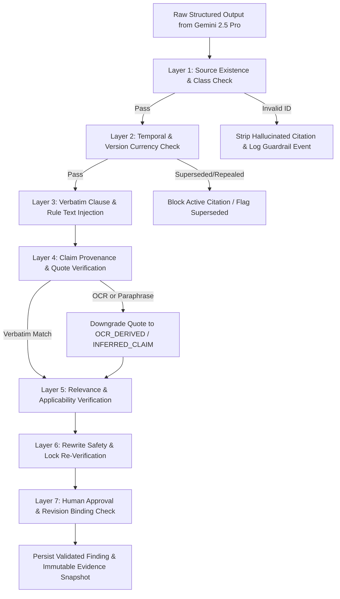

# COGENT MARKETING SHIELD
## Regulatory Evidence and Compliance Guardrails Specification

**Product Name:** Cogent Marketing Shield  
**Product Type:** Standalone Enterprise Regulatory & Marketing Compliance Operating System  
**Document Number:** 05  
**Document Title:** Regulatory Evidence and Compliance Guardrails Specification  
**Version:** 2.0 (Greenfield Source of Truth)  
**Status:** Approved Technical Baseline — Trust, Retrieval, and Guardrail Architecture  
**Priority:** Critical — Zero-Hallucination & Evidence Integrity Foundation  
**AI Provider & SDK:** Google Gemini API (`@google/genai` SDK — Gemini 2.5 Pro, Gemini 2.5 Flash, `text-embedding-004`)  
**Primary Jurisdiction:** Federal Republic of Nigeria (CBN, FCCPC, ARCON, NDPC, SEC)

---

# 1. Executive Purpose & Trust Standard

## 1.1 Why This Document Exists

Cogent Marketing Shield's entire value proposition to Nigerian financial institutions rests on one non-negotiable guarantee: **every compliance finding, statutory citation, internal playbook flag, and rewrite recommendation is verifiable, deterministic where possible, and traceable to an authoritative source.**

In regulated financial services marketing, a language model generating a convincing legal explanation does not establish that the explanation is accurate. Specifically:
- A citation string generated by an LLM does not prove the section exists.
- A real statutory provision that shares keywords with an advertisement does not automatically apply to the institution's license category, product type, or marketing channel.
- A live web article or legal blog post retrieved from the internet is not equivalent to a gazetted Act or an official Central Bank of Nigeria (CBN) circular.
- A proposed rewrite that "sounds safer" is a liability if it invents an unapproved interest rate or drops a mandatory statutory disclosure.

This specification defines the complete **Three-Source Evidence Architecture**, the **Golden 50 Statutory Corpus Standard**, the **3 Deterministic Mechanical Locks**, and the **7-Layer Compliance Guardrail Pipeline** (`src/modules/regulatory-vault/`, `src/modules/institutional-knowledge/`, `src/modules/live-web-intelligence/`, and `src/modules/compliance-assessment/`).

## 1.2 Core Governing Principle

**Gemini is the reasoning and synthesis engine, never the source of regulatory or institutional truth.**

All authoritative facts—statutory clauses, effective dates, internal company rules, and approved product interest rates/fees—reside in verified PostgreSQL records. Gemini may only reference records supplied or resolved by the backend, and every structured finding generated by Gemini must pass the **7-Layer Backend Guardrail Validator** before it can be stored in `compliance_findings` or displayed to a user.

---

# 2. Three-Source Intelligence & Source-Class Governance

## 2.1 Strict Source-Class Taxonomy

Cogent Marketing Shield enforces a strict 5-tier source classification across database storage, retrieval ranking, guardrail validation, and frontend UI badges:

| Source Class Enum | UI Trust Badge | Authority Level | Description & Examples | Allowed Use in Assessments |
|---|---|---|---|---|
| `VERIFIED_OFFICIAL_SOURCE` (Class A) | **`[Verified Statutory Vault]`** | Primary Statutory Authority | Acts of the National Assembly, official CBN Circulars/Guidelines, FCCPC Regulations, ARCON Act/Codes, NDPA 2023/GAID, SEC Rules stored in the Golden 50 Vault. | Can support definitive `VERIFIED` statutory findings and block approval until remediated. |
| `OFFICIAL_EXPLANATORY_GUIDANCE` (Class B) | **`[Official Regulator Guidance]`** | Secondary Official Guidance | Official regulator FAQs, explanatory notes, and implementation notices published on `.gov.ng` domains. | Supports interpretation of Class A provisions; cannot override a Class A statutory clause. |
| `INTERNAL_PLAYBOOK` (Class C) | **`[Internal Playbook Rule]`** | Binding Institutional Authority (Tenant-Scoped) | Active rules in `marketing_knowledge_rules`, chunks in `marketing_knowledge_chunks`, and product truth in `campaign_products`. | Enforces company-specific policies, brand rules, and rate/fee accuracy within `tenant_id` only. Never presented as national law. |
| `LIVE_WEB_INTELLIGENCE` (Class D) | **`[Live Web Intelligence]`** | Real-Time Informational / Breaking Alert | Live web search results (`live_web_retrievals`) from `search_live_web` (official regulator announcements, press releases, legal updates). | Alerts users to breaking circulars or enforcement news; requires human review (`requires_human_review = true`) unless promoted into Class A Vault. |
| `UNTRUSTED_USER_MATERIAL` (Class E) | **`[Submitted Campaign Material]`** | Passive Target Data Only | Uploaded flyers, PDFs, DOCX files, pasted ad copy, and fetched promotional URLs (`fetch_live_url_content`). | Evaluated *as the subject of compliance assessment*. Never treated as regulatory truth or system instructions. |

## 2.2 Non-Contamination Rules
1. **Zero Silent Promotion:** A `LIVE_WEB_INTELLIGENCE` snippet or secondary legal commentary can never automatically insert itself into `regulatory_clauses` as a `VERIFIED_OFFICIAL_SOURCE`. Promoting a newly discovered circular from Live Web into the Statutory Vault requires the controlled Admin Ingestion & Verification Pipeline (Section 4).
2. **Strict Statutory vs. Internal Separation:** Findings backed by `regulatory_clause_id` or `regulatory_obligation_id` are labeled as **Statutory Compliance Findings**. Findings backed by `knowledge_rule_id` or `campaign_products` are labeled as **Internal Playbook & Product Truth Findings**. The system never tells a user that an internal company brand rule is a CBN or ARCON law.

---

# 3. The "Golden 50" Nigerian Statutory Vault Architecture

## 3.1 The Golden 50 Baseline Scope
To eliminate the cold-start problem and guarantee Day-1 institutional trust across Nigerian fintechs, digital lenders, microfinance banks, PSBs, MMOs, commercial banks, and WealthTech platforms, the Statutory Vault (`regulatory_bodies`, `regulatory_instruments`, `regulatory_document_versions`, `regulatory_clauses`, `regulatory_obligations`, `applicability_rules`) is seeded with the **Golden 50 Nigerian Regulatory Instruments** across the 5 primary regulators:

### 1. Central Bank of Nigeria (`CBN`) — 14 Core Instruments
- Consumer Protection Framework (CPF) & Consumer Protection Regulations (Fair treatment, disclosure & transparency, responsible business conduct, advertising rules).
- Guidelines on Operations of Electronic Payment Channels in Nigeria.
- Regulatory Framework for Mobile Money Services & Payment Service Banks (PSBs).
- Revised Regulatory and Supervisory Guidelines for Microfinance Banks (MFBs) in Nigeria.
- Guide to Charges by Banks, Other Financial and Non-Bank Financial Institutions (APR, fee transparency, prohibited hidden charges).
- CBN Circulars on Digital Lending, Credit Reference Bureaus, and Fair Debt Recovery Practices.
- CBN Directives on Mandatory Licensing Disclosures and NDIC Deposit Insurance Representations.
- CBN AML/CFT/CPF Customer Onboarding & Promotional KYC Communication Rules.
- CBN Risk-Based Cybersecurity Framework & Fraud Warning Disclosure Directives.

### 2. Federal Competition and Consumer Protection Commission (`FCCPC`) — 11 Core Instruments
- Federal Competition and Consumer Protection Act (FCCPA) 2018 (Part XV — Consumer Rights, Misleading/Deceptive Representations, Bait Advertising, Unfair Contract Terms).
- Limited Interim Regulatory/Registration Framework and Guidelines for Digital Lending (Mandatory registration, fee/interest transparency, prohibition of abusive marketing/recovery practices).
- Sales Promotion (Amended) Regulations (Registration of promotions, digital/influencer/automated AI marketing rules, Regulation 32 mandatory 2-year promotional record retention, Regulation 33 joint influencer liability, and administrative penalty frameworks up to ₦100M or 1% turnover).
- FCCPC Guidelines on Deceptive Pricing, Drip Pricing, and "Zero-Fee / 0% Interest" Substantiation.

### 3. Advertising Regulatory Council of Nigeria (`ARCON`) — 10 Core Instruments
- Advertising Regulatory Council of Nigeria (ARCON) Act (Statutory mandate, Advertising Standards Panel [ASP] pre-vetting requirement prior to publication/exposure, Advertising Offences Tribunal, and penalty schedules).
- Nigerian Code of Advertising Practice, Sales Promotion and Other Rights/Restrictions on Practice (Decency, truthfulness, substantiation, comparative advertising, testimonials, endorsements, financial services advertising).
- ARCON ASP Pre-Vetting Guidelines for Financial Services, Loans, Lotteries, and Promotional Draws.
- ARCON Directives on Digital Media, Social Media Skit Makers, Brand Ambassadors, and Influencer Advertising Pre-Clearance.

### 4. Nigeria Data Protection Commission (`NDPC`) — 7 Core Instruments
- Nigeria Data Protection Act (NDPA) 2023 (Lawful basis for processing in marketing, explicit opt-in consent, right to object to direct marketing, transparency of privacy notices).
- NDPC General Application and Implementation Directive (GAID) (Direct marketing via SMS/Email/WhatsApp, cookie/tracking disclosures on promotional landing pages, third-party data sharing in co-branded promos).

### 5. Securities and Exchange Commission (`SEC`) — 8 Core Instruments
- Investments and Securities Act (ISA) & SEC Consolidated Rules (Restrictions on unsolicited investment invitations, mandatory risk warnings, prohibition of guaranteed return claims on variable investments).
- SEC Rules on Issuance, Offering Platforms and Custody of Digital Assets / VASPs (Promotional restrictions and mandatory risk disclaimers for crypto/digital assets).
- SEC Rules on Robo-Advisory Services and Collective Investment Schemes (Historical performance disclosure rules: *"Past performance is not a reliable indicator of future results"*).

---

## 3.2 Provenance & Cryptographic Integrity Chain

Every statutory provision in the Golden 50 Vault maintains an unbroken relational provenance chain:

```text
regulatory_bodies (CBN / FCCPC / ARCON / NDPC / SEC)
  └── regulatory_instruments (Official Title, Instrument Type, Jurisdiction)
        └── regulatory_document_versions (Version Number, Official URL, SHA-256 Document Hash, Publication Date, Effective Date, Lifecycle Status: CURRENT / SUPERSEDED / FUTURE_EFFECTIVE / REPEALED)
              └── regulatory_clauses (Clause Reference e.g. "Reg 32(1)", Verbatim Clause Text, Page Number, VECTOR(768) Embedding)
                    └── regulatory_obligations (Structured Obligation Text, Type: PROHIBITIVE / DISCLOSURE / PRESCRIPTIVE, Severity)
                          └── applicability_rules (Institution Type, Product Type, Activity Type, Channel, JSONB Conditions)
```

---

# 4. Controlled Ingestion, Extraction & Embedding Pipeline

## 4.1 Statutory Vault Ingestion Pipeline
To guarantee that unverified or corrupted text never enters the Statutory Vault, ingestion follows an 11-step controlled pipeline:
1. **Source Acquisition & Hashing:** Official PDF/document is acquired from the regulator's source, hashed (`sha256`), and stored immutably in private object storage (`regulatory-vault/{regulator}/{instrument_id}/{version_id}.pdf`).
2. **Version & Temporal Registration:** `regulatory_document_versions` record is created with `verification_status = 'PENDING'` and exact `publication_date` and `effective_date`.
3. **Structure-Preserving Parsing:** Document text is parsed preserving exact section/clause numbers, sub-paragraphs, negations (*"shall not"*, *"except where"*), numerical thresholds, and page numbers.
4. **Verbatim Clause Persistence:** Clauses are inserted into `regulatory_clauses` (`verification_status = 'PENDING'`). Paraphrasing statutory text inside `clause_text` is strictly forbidden.
5. **Obligation & Applicability Extraction:** Structured obligations (`regulatory_obligations`) and applicability matrices (`applicability_rules`) are extracted and linked to their parent `clause_id`.
6. **Verification Gate:** Automated integrity checks (verifying that `clause_text` is a substring of the source page text) and human/admin verification transition `verification_status` to `'VERIFIED_OFFICIAL_SOURCE'`.
7. **Asynchronous Embedding Generation (`REGULATORY_CORPUS_EMBEDDING`):**
   - Enqueued in `processing_jobs`.
   - Application worker invokes `@google/genai` with model `text-embedding-004` (`768` dimensions).
   - Worker validates vector length (`768`) and non-zero norm before writing `embedding` and `embedded_at` to `regulatory_clauses`.
   - **Zero Null-Embedding Blind Spot:** A clause cannot be marked active for semantic retrieval until `embedding IS NOT NULL`.

## 4.2 Institutional Playbook Ingestion Pipeline (`PLAYBOOK_DOCUMENT_INGESTION`)
When a tenant uploads an internal policy PDF/DOCX or updates product terms:
1. File is stored under `tenants/{tenant_id}/knowledge/{asset_id}` and registered in `marketing_knowledge_documents`.
2. Worker extracts text, segments it into overlapping semantic sections (`marketing_knowledge_chunks`), and generates `VECTOR(768)` embeddings using `text-embedding-004`.
3. Worker extracts candidate structured rules into `marketing_knowledge_rules` (`status = 'DRAFT'`).
4. Once an authorized `LEGAL_COUNSEL`, `CHIEF_COMPLIANCE_OFFICER`, or `WORKSPACE_ADMIN` activates the rule (`status = 'ACTIVE'`), it is immediately enforced by the Autonomous Campaign Analyst.

---

# 5. Hybrid Retrieval & Applicability Engine

## 5.1 Hybrid Reciprocal Rank Fusion (RRF) Retrieval
Neither vector search alone nor keyword search alone is sufficient for legal compliance (vector search captures semantic intent like *"no hidden charges"*, while full-text search captures exact statutory identifiers like *"Regulation 32"* or *"ARCON ASP"*).

For both the Statutory Vault (`search_regulatory_evidence`) and the Institutional Knowledge Base (`search_institutional_knowledge`), the backend executes **Hybrid RRF Retrieval**:

1. **Dense Semantic Search (`pgvector`):**
   - Embeds the query with `text-embedding-004`.
   - Queries `regulatory_clauses` (filtered by `lifecycle_status = 'CURRENT'`, `verification_status = 'VERIFIED'`, `effective_date <= as_of_date`, and optional `regulator_id`) using cosine distance (`1 - (embedding <=> query_embedding)`), returning top $K = 25$ ranked by semantic similarity ($r_{\text{vec}}$).
2. **Lexical Full-Text Search (PostgreSQL FTS):**
   - Queries `to_tsvector('english', clause_text)` using `websearch_to_tsquery('english', query)` with `ts_rank_cd`, returning top $K = 25$ ranked by lexical match ($r_{\text{fts}}$).
3. **Reciprocal Rank Fusion (RRF) Scoring:**
   - Combines both ranked lists using the RRF formula with constant $k = 60$:
     $$\text{RRF\_Score}(d) = \frac{1}{k + r_{\text{vec}}(d)} + \frac{1}{k + r_{\text{fts}}(d)}$$
   - Returns the top $N$ highest-scoring clauses along with their full instrument provenance and linked `regulatory_obligations`.

## 5.2 Temporal & Version Resolution Rules
- **Default Current-Law Enforcement:** Unless `include_superseded = true` is explicitly passed for a historical audit, retrieval strictly filters for `lifecycle_status = 'CURRENT'` and `effective_date <= CURRENT_DATE`.
- **Future-Effective Awareness:** If a retrieved instrument has `lifecycle_status = 'FUTURE_EFFECTIVE'` (`effective_date > CURRENT_DATE`), the retrieval engine includes it only as a proactive warning, explicitly badging its future commencement date so it is not confused with currently operative law.
- **Supersession Blocking:** If a user asks about a repealed or superseded circular, the system identifies that the instrument is `SUPERSEDED` and points to the superseding instrument via `regulatory_source_relationships`.

## 5.3 Applicability Evaluation Engine (`assess_regulatory_applicability`)
Retrieval establishes **topic relevance**, not **legal applicability**. Before a retrieved obligation is applied to a campaign claim, the Applicability Engine evaluates four contextual dimensions:
1. **Institution License Type:** e.g., `DIGITAL_LENDER`, `MFB`, `PSB`, `MMO`, `COMMERCIAL_BANK`, `WEALTHTECH`. (A SEC collective investment rule does not apply to a pure CBN microfinance deposit ad unless investment products are promoted).
2. **Product Category:** e.g., `DIGITAL_LENDING`, `SAVINGS_DEPOSIT`, `PAYMENTS`, `INVESTMENT`, `CRYPTO_VASP`.
3. **Communication Channel:** e.g., `SMS` (character-constrained disclosure rules), `SOCIAL_MEDIA`, `PRINT_FLYER`, `INFLUENCER` (triggers FCCPC Reg 33 & ARCON influencer rules), `WEB_LANDING`.
4. **Conditional Triggers:** e.g., Whether the ad states a specific numerical interest rate/fee (which triggers mandatory APR/total cost of credit disclosures under CBN CPF).

If required applicability context is missing from the campaign metadata, the engine sets `applicability_status = 'APPLICABILITY_UNCERTAIN'` and prompts the user rather than guessing.

---

# 6. The 3 Deterministic Mechanical Locks

Before invoking Gemini for nuanced contextual reasoning, the backend executes three deterministic, code-enforced checks (`run_deterministic_compliance_locks`) on every campaign revision:

## 6.1 Lock 1 — Prohibited & Restricted Terms Scanner
- Scans `campaign_revisions.content_text` and all linked `asset_extraction_segments` against active global statutory and tenant-specific records in `prohibited_terms` (`EXACT`, `PHRASE`, and `REGEX` modes).
- Flags high-risk absolutes and restricted phrases (e.g., *"100% risk-free investment"*, *"CBN guaranteed returns"*, *"instant loan no credit check ever"*, *"free money"*).
- Passes exact matched offsets and surrounding sentence context to the assessment engine so contextual exceptions (such as a negation in a disclaimer) are verified while genuine promotional usages are deterministically flagged.

## 6.2 Lock 2 — Product Rate, Fee & Tenor Truth Matcher (`campaign_products`)
- Extracts all numerical financial representations from the campaign (percentage rates, Naira fee amounts, "0% / zero fee" claims, repayment tenors in days/months).
- Compares those extracted numbers deterministically against the structured JSONB terms in the linked `campaign_products` record:
  - `interest_rate_min` / `interest_rate_max`
  - `apr_min` / `apr_max`
  - `processing_fee_percent` / `processing_fee_flat_ngn`
  - `late_penalty_fee_percent`
  - `min_tenor_days` / `max_tenor_days`
- **Deterministic Fail Rule:** If an ad claims *"0% processing fee"* or *"2% monthly interest"* when `campaign_products` specifies `processing_fee_percent: 1.5` or `interest_rate_min: 4.0`, Lock 2 immediately fails and generates a `CRITICAL` / `HIGH` finding citing the exact product rate sheet discrepancy.

## 6.3 Lock 3 — Mandatory Statutory & Institutional Disclosure Checker
- Checks whether required statutory and internal disclosures configured for the campaign's `channel` and `product_type` are present in the text or flyer OCR segments:
  - Regulatory licensing statement (e.g., *"Licensed by the Central Bank of Nigeria"*).
  - Deposit insurance statement where applicable (e.g., *"Deposits insured by NDIC"*).
  - Terms and conditions qualification (e.g., *"Terms and conditions apply"*).
  - Product-specific mandatory disclaimers defined in `marketing_knowledge_rules` (`rule_type = 'REQUIRED_DISCLOSURE'`).
- **Deterministic Fail Rule:** If a required disclosure is absent (or illegible in low-confidence OCR), Lock 3 fails and generates a structured finding with the exact verbatim disclaimer text needed to remediate the campaign.

---

# 7. The 7-Layer Compliance Guardrail Pipeline

Every structured output returned by Gemini during campaign assessment or rewrite generation must pass through the **7-Layer Guardrail Validator** (`src/modules/compliance-assessment/guardrails.validator.ts`) before persistence:



## 7.1 Detailed Layer Rules

1. **Layer 1 — Source Existence & Authority Check:**
   - Queries PostgreSQL to confirm that every `regulatory_clause_id`, `regulatory_obligation_id`, `knowledge_rule_id`, or `live_web_retrieval_id` referenced by the model actually exists and belongs to the authorized global or `tenant_id` scope.
   - If Gemini invents a UUID or cites a non-existent section, Layer 1 strips the invalid citation, logs a `GUARDRAIL_CITATION_REJECTED` event, and prevents the finding from being marked `VERIFIED`.

2. **Layer 2 — Temporal & Lifecycle Status Check:**
   - Confirms the parent `regulatory_document_versions` record has `lifecycle_status = 'CURRENT'` and `effective_date <= assessment_date` (or `marketing_knowledge_rules.status = 'ACTIVE'`).
   - Prevents superseded or draft instruments from being enforced as current mandatory law.

3. **Layer 3 — Provision & Verbatim Text Injection:**
   - The backend never trusts Gemini to quote a statute from memory. Once `regulatory_clause_id` or `knowledge_rule_id` is resolved, Layer 3 pulls the exact `clause_text` or `rule_text` directly from PostgreSQL, computes its `source_text_hash`, and stores an immutable copy in `assessment_evidence_snapshots`.

4. **Layer 4 — Claim Provenance & Verbatim Quote Check:**
   - Verifies that the campaign excerpt cited in a finding (`claim_text`) is an exact substring of `campaign_revisions.content_text` or `asset_extraction_segments.text_content`.
   - If the claim came from flyer OCR (`source_type = 'OCR'`), Layer 4 attaches the `OCR` provenance badge and bounding-box coordinates (`page_number`, `bounding_box`). If `extraction_confidence < 0.80`, it flags `EXTRACTION_UNCERTAIN`.

5. **Layer 5 — Relevance & Applicability Check:**
   - Verifies that the cited provision's `applicability_rules` match the campaign's institution type, product category, and channel.
   - If applicability conditions are unconfirmed, Layer 5 overrides the finding's `applicability_status` to `'APPLICABILITY_UNCERTAIN'` and sets `requires_human_review = true`.

6. **Layer 6 — Rewrite Safety & Deterministic Re-Verification:**
   - Whenever Gemini proposes a compliant rewrite (`generate_rewrite_suggestions`), Layer 6 automatically runs **Locks 1, 2, and 3** on the `proposed_text` before returning it to the user:
     - Checks that no prohibited terms were introduced.
     - Checks that no interest rates, APRs, fees, or tenors were invented or altered relative to `campaign_products`.
     - Checks that all mandatory disclosures are preserved.
   - If any check fails, Layer 6 blocks the `PASSED` badge and returns `REWRITE_VALIDATION_FAILED` with the exact failure reason.

7. **Layer 7 — Human Approval & Immutable Revision Binding:**
   - Enforces that no AI output, tool call, or automated reassessment can ever transition a campaign to `APPROVED`.
   - When an authorized human (`LEGAL_COUNSEL` or `CHIEF_COMPLIANCE_OFFICER`) approves a campaign, Layer 7 binds the approval record to the exact `revision_id` and `assessment_evidence_snapshots`. Any subsequent edit creates `revision_number = N + 1` and automatically invalidates carry-over approval.

---

# 8. Uncertainty States & Mandatory Human Escalation

## 8.1 Standardized Uncertainty & Verification Enums
Every finding and applicability assessment must carry an explicit status rather than binary pass/fail guesswork:
- `VERIFIED` — Backed by a current Class A statutory clause or active Class C internal rule with confirmed applicability and verbatim claim provenance.
- `POTENTIALLY_APPLICABLE` — Provision is verified, but applicability depends on how the promotion is executed in practice.
- `APPLICABILITY_UNCERTAIN` — Missing institutional license, product, or channel context required to confirm applicability.
- `INSUFFICIENT_EVIDENCE` — Neither the Statutory Vault nor the Institutional Playbook contains a verified rule governing the specific question.
- `EXTRACTION_UNCERTAIN` — Claim was extracted via low-confidence OCR and requires human visual inspection of the flyer.
- `LIVE_WEB_UNVERIFIED` — Grounded in real-time web intelligence (`search_live_web`) that has not yet been formally ingested into the Statutory Vault.

## 8.2 Mandatory Human Review Triggers (`requires_human_review = true`)
The backend automatically sets `requires_human_review = true` on any finding where:
1. `severity` is `CRITICAL` or `HIGH`.
2. `applicability_status` is `APPLICABILITY_UNCERTAIN` or `INSUFFICIENT_EVIDENCE`.
3. Supporting evidence comes from `LIVE_WEB_INTELLIGENCE`.
4. Two retrieved provisions or internal rules appear to conflict.
5. OCR extraction confidence on the underlying claim segment is below `80%`.

---

# 9. Golden 50 Benchmark & Evaluation Governance

Before production release and on every change to embeddings, RRF ranking weights, or Gemini model versions, the engineering team must run the automated **Golden 50 Retrieval & Guardrail Benchmark Suite** (`tests/benchmarks/golden_50.bench.ts`):

| Benchmark Metric | Target Release Threshold | What It Verifies |
|---|---|---|
| **Hit Rate @ 5 (Hybrid RRF)** | `>= 92%` | Expected statutory clause appears in top 5 retrieved results across 150 verified Nigerian fintech test queries. |
| **Mean Reciprocal Rank (MRR @ 10)** | `>= 0.80` | Primary expected statutory provision ranks at or near position #1. |
| **Hallucinated Citation Rejection Rate** | `100%` | Layer 1/3 Guardrails block 100% of synthetic/fabricated `clause_id` or section references in adversarial tests. |
| **Superseded Provision Blocking Rate** | `100%` | Layer 2 Guardrail blocks 100% of `SUPERSEDED` or `REPEALED` provisions from being cited as current active law. |
| **Deterministic Lock 2 Rate-Mismatch Detection** | `100%` | Lock 2 catches 100% of test flyers/captions where advertised interest rates or fees contradict `campaign_products`. |
| **Layer 6 Unsafe Rewrite Interception Rate** | `100%` | Layer 6 blocks 100% of test rewrites that invent an unapproved interest rate or drop a mandatory CBN/FCCPC disclosure. |

---

# 10. Acceptance Criteria

This specification is satisfied during implementation only when:
1. The **Golden 50 Nigerian Regulatory Instruments** are seeded, hashed (`sha256`), parsed into verbatim `regulatory_clauses` and `regulatory_obligations`, and embedded (`VECTOR(768)`) with zero null embeddings.
2. Hybrid RRF Retrieval (`pgvector` + PostgreSQL FTS) operates across both the Statutory Vault and the tenant-isolated Institutional Knowledge Base.
3. All **3 Deterministic Mechanical Locks** execute deterministically before and after Gemini reasoning.
4. All **7 Guardrail Validation Layers** execute on every assessment and rewrite proposal, persisting immutable `assessment_evidence_snapshots`.
5. Every finding and citation in the database, API, and UI preserves strict source-class attribution (`[Verified Statutory Vault]`, `[Internal Playbook Rule]`, `[Live Web Intelligence]`).

**End of Document 05 — Regulatory Evidence and Compliance Guardrails Specification.**